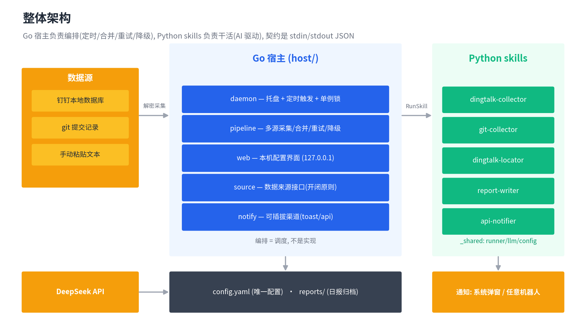
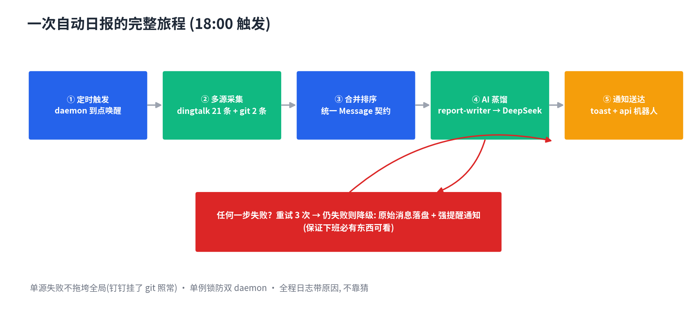
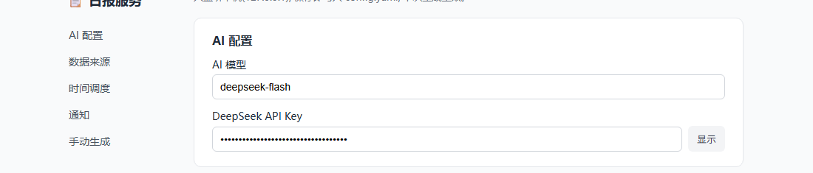
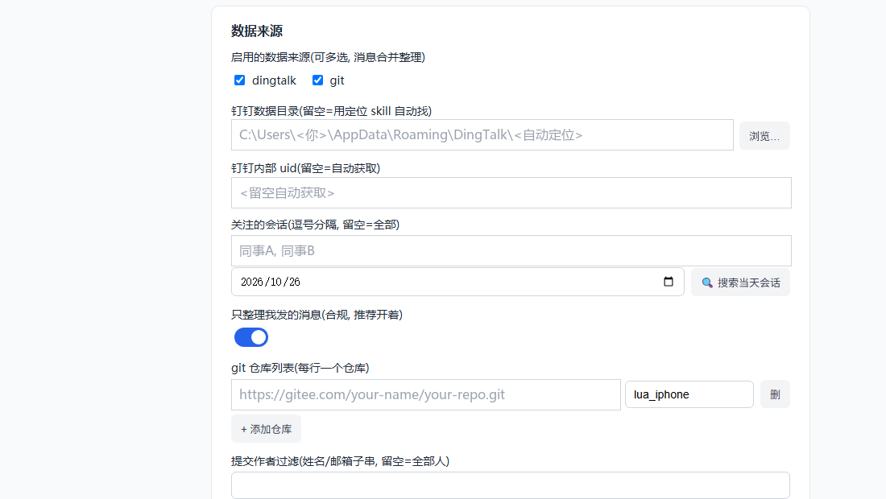
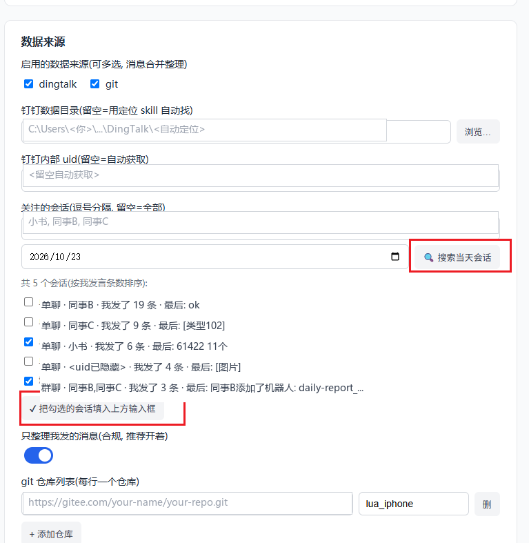
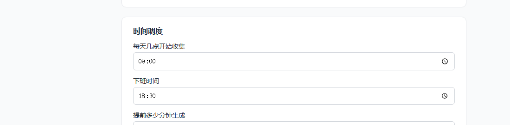
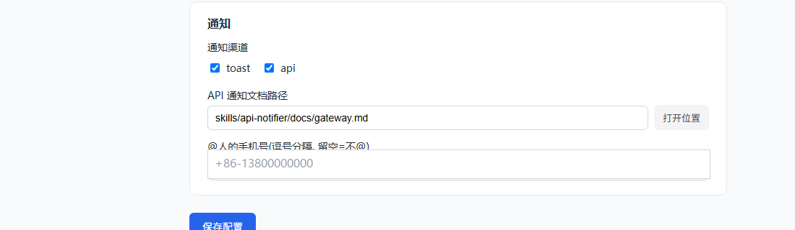
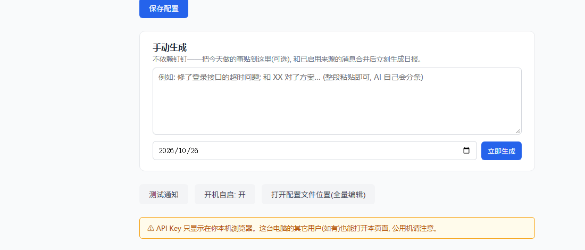

<div align="center">

# 📋 Auto Daily Report

**下班前自动把"你今天干了什么"整理好，发到你的钉钉。**

多源采集（钉钉聊天 · git 提交 · 随手粘贴）→ DeepSeek 蒸馏 → 系统弹窗 / 任意机器人通知。

一台 Windows 电脑 + 一个 DeepSeek Key，部署完就不用再管它了。


**中文** | [English](#english)

</div>





---

## 特性

- ⏰ **定时无人值守** — 住在系统托盘，下班前 30 分钟自动跑完全部流程，单例锁防双开
- 💬 **钉钉消息采集** — 解密本地钉钉数据库（AES），自动定位数据目录、自动获取 uid，**只整理你自己发的消息**（合规）
- 🌿 **git 提交采集** — 本地路径或远程 URL 都行，远程自动克隆缓存、增量拉取
- 🤖 **AI 蒸馏日报** — 所有来源的证据合并成一锅，交给 DeepSeek 提炼成"今日完成 / 进行中 / 风险与阻塞"
- 📢 **可插拔通知** — 系统弹窗 + 任意机器人（钉钉/微信/ServerChan…换服务 = 换一份 API 文档，零代码）
- 🛡️ **失败不白干** — 重试 3 次，仍失败则降级输出原始消息并强提醒，保证下班必有东西可看
- 🧩 **skill 化架构** — 每个能力是一个"AI skill"，读懂 SKILL.md 就能扩展，这是可以带走的真正主题

---

## 目录

1. [安装](#一安装)
2. [使用](#二使用)
3. [设计](#三设计)
4. [English](#english)

---

## 一、安装

### 环境要求

| 依赖 | 版本 | 用途 |
|---|---|---|
| Windows | 10/11 | 托盘、气球通知、注册表自启都是 Windows 机制 |
| Go | 1.21+ | 编译宿主（只需构建时有） |
| Python | 3.10+ | 运行 skills |
| git | 任意 | git 来源需要；克隆远程仓库 |
| DeepSeek API Key | — | [platform.deepseek.com](https://platform.deepseek.com) 申请 |

### 步骤

```powershell
# 1. 克隆
git clone https://github.com/PonyMBZ/auto-daily-report.git
cd auto-daily-report

# 2. Python 环境（skills 运行时用）
python -m venv .venv
.\.venv\Scripts\Activate.ps1
pip install pyyaml pycryptodome

# 3. 编译宿主（产物 = 项目根下的 daily-report.exe）
cd host
go build -o ..\daily-report.exe .
cd ..

# 4. 配置：复制模板，填入你的 DeepSeek Key
copy config.example.yaml config.yaml
notepad config.yaml

# 5. 启动配置界面（自动打开浏览器）
.\daily-report.exe serve

# 6. 配置满意后，常驻托盘
.\daily-report.exe daemon
```

> 💡 也可以跳过编译：`cd host && go run . serve`

### 验证安装

```powershell
.\daily-report.exe daemon --check    # 打印下次触发时间, 不驻留
.\daily-report.exe pipeline          # 立刻手动跑一遍今天的完整流程
.\daily-report.exe notify            # 测试通知渠道
```

---

## 二、使用

### 2.1 配置界面：手把手（推荐入口）

daemon 运行后，**从托盘图标右键菜单点"打开配置界面"**（界面只监听 `127.0.0.1`，API Key 不出本机）。左侧 5 个导航对应 5 屏，按顺序过一遍：

#### 第 1 屏：AI 配置 —— 唯一必填项



| 字段 | 填什么 | 说明 |
|---|---|---|
| AI 模型 | `deepseek-chat`（深度思考）或 `deepseek-flash`（便宜快速） | 只用于整理消息，flash 足够 |
| DeepSeek API Key | 你的 `sk-...` key | **全项目唯一必填**。点"显示"核对，配置页只在本机浏览器显示 |

**怎么测**：填完 key 先别走——拉到页面底部点"测试通知"，如果通知能弹出来，说明 key 和通知都通了。

#### 第 2 屏：数据来源 —— 消息从哪来



- **启用的数据源**：勾 dingtalk（聊天记录）、git（代码提交），可多选，消息合并整理
- **钉钉数据目录 / 内部 uid**：**都留空**，定位 skill 会自动扫描本机钉钉、AI 验证后回填。自动定位失败再手动填
- **关注的会话**：决定提取哪些聊天的消息。**留空 = 全部会话**（消息多、生成慢）；填群名或同事名（逗号分隔，包含匹配，如填"脚本"会匹配"脚本部"）
- **搜索当天会话**（推荐用法，不用手打名字）：

  

  ① 选个日期 → ② 点"🔍 搜索当天会话"，下方列出当天所有群聊/单聊（按你的发言条数排序，带最后一条消息摘要，方便认人）→ ③ 勾选要提取的会话 → ④ 点"✓ 把勾选的会话填入上方输入框"，自动回填。记得再点"保存配置"
- **只整理我发的消息**：建议开着（合规，日报本来就是写你做的事）
- **git 仓库列表**：每行一个仓库，远程 URL（自动克隆缓存）或本地路径都行；**提交作者过滤**用来只统计某些人的提交——不用手敲，点它下方的"📖 从仓库读取作者"，服务会去仓库里 `git log` 出全部提交作者渲染成多选框，勾选后点"✓ 把勾选的作者填入上方输入框"即可；也支持手填，逗号分隔多个 = 任一命中（姓名/邮箱子串匹配），留空 = 全部人

**怎么测**：勾好来源后，点"🔍 搜索当天会话"能列出会话 = 钉钉解密链路通了；git 仓库行填好后点"📖 从仓库读取作者"能列出作者 = git 链路通了。

#### 第 3 屏：时间调度 —— 什么时候生成



三个时间凑出触发时刻：**生成时间 = 下班时间 − 提前分钟数**。

例：下班 `18:30` − 提前 `30` 分钟 = **每天 18:00 自动生成**，`09:00` 开始收集。改完点"保存配置"。

#### 第 4 屏：通知 —— 写完日报怎么告诉你



- **toast**：Windows 右下角弹窗（截断 200 字），点弹窗看全文
- **api**：把日报全文推给你的机器人（钉钉/企业微信自定义机器人等）。AI 读 `API 通知文档路径` 指向的文档，自己拼请求——**换通知平台 = 换一份文档，零代码**
- **@人的手机号**：填了才会在推送里 @你（代码强制 content 末尾带 @号码，不靠 AI 记）

**怎么测**：点页面底部"测试通知"，两种渠道各弹一次才算通。

#### 第 5 屏：手动生成 & 工具按钮



- **大输入框 + 立即生成**：不依赖钉钉——把今天做的事整段粘贴（可多段），和已启用来源的消息**合并**后立即生成。适合补写昨天的日报（改日期）
- **测试通知**：通知渠道试收发
- **开机自启：开/关**：点击切换，双保险写注册表 + 启动文件夹，完全无窗口
- **打开配置文件位置**：config.yaml 全量编辑（界面没暴露的高级项）

#### 配置策略：留空就行

| 配置 | 留空时的行为 |
|---|---|
| `dingtalk.data_dir` | AI 定位 skill 自动扫描 + 代码验证 |
| `dingtalk.uid` | 自动推导你的 uid |
| `collect.conversations` | 关注全部会话（建议用"搜索当天会话"勾选回填） |
| `notify.api.at_mobiles` | 不 @ 任何人 |
| `git.repos` | git 来源无数据（不报错） |

### 2.2 配置项速览

```yaml
llm:
  provider: deepseek
  model: deepseek-chat
  api_key: "sk-你的key"

sources: [dingtalk, git]        # 启用的数据来源, 可多选, 消息合并整理

dingtalk:
  data_dir: ""                  # 钉钉数据目录, 留空=自动找
  uid: ""                       # 内部 uid, 留空=自动获取

collect:
  conversations: []             # 关注的会话(包含匹配): 群写群名一部分; 留空=全部
  only_mine: true               # true = 只整理我发的消息(合规, 推荐开着)
  since_hour: "09:00"           # 每天几点开始收集

git:
  repos:
    - path: "https://github.com/you/your-project.git"   # 远程地址(自动克隆缓存)
      name: "后台服务"                                     # 或直接写本地路径
  author: ""                  # 只统计你的提交(姓名/邮箱子串), 留空=全部人

schedule:
  work_end: "18:30"           # 下班时间
  lead_minutes: 30            # 提前多少分钟生成 → 18:00 触发

notify:
  channels: [toast, api]      # toast=系统弹窗; api=AI 读文档拼请求
  api:
    doc_file: skills/api-notifier/docs/gateway.example.md   # 机器人 API 文档
    at_mobiles: ["+86-13800000000"]           # 要@的人, 填了才会真的@
```

> 换通知机器人（企业微信 / ServerChan / Bark…）：把它的 API 文档写成 markdown，改 `doc_file` 指向它——**零代码**。@人规则（atMobiles + content 末尾 @号码）由代码强制保证，不依赖 AI 记得。

### 2.3 日常使用

| 操作 | 方式 |
|---|---|
| 自动日报 | 到点自动：采集 → 蒸馏 → 弹窗 + 机器人推送全文 |
| 手动生成 | 配置页底部"手动生成"区，可粘贴补充内容，可选任意日期（补写昨天） |
| 测试通知 | 配置页"测试通知"按钮 |
| 看历史日报 | `reports/` 按日期归档；托盘菜单"打开报告目录" |
| 开机自启 | 托盘菜单一键开关，双保险写注册表 Run 键 + 启动文件夹 VBS，完全无窗口 |

### 2.4 ⚠️ 新手会踩的坑（都是真实踩过的）

1. **配置页打不开/按钮报错 `ERR_CONNECTION_REFUSED`** —— 配置页端口是随机的，daemon 每重启一次地址就变。**永远从托盘菜单"打开配置界面"进入**，旧标签页关掉。
2. **只能有一个 daemon** —— 系统级单例锁，第二个实例会拒绝启动并提示。`daemon --check` 可查看状态。
3. **18:00 没动静** —— daemon 没运行。托盘图标在 = 在运行。
4. **"立即生成"的日期** —— 两个日期选择器（会话搜索 / 手动生成）已联动并记忆；定时任务永远生成"当天"，互不影响。
5. **钉钉没抓到消息** —— 确认配置页"数据来源"勾了 dingtalk；确认钉钉在登录状态（数据库要能解密）。
6. **@不到人** —— `at_mobiles` 必须填手机号；只写群不@就留空。
7. **DeepSeek 报 401** —— key 错了或欠费；报 402/429 —— 余额不足/限流。
8. **想看原始消息** —— 每次生成同时落盘 `reports/<日期>.md` 与消息明细，AI 只是整理工。
9. **开机自启没生效** —— 先看 `logs/launch.log`：有新增行说明进程起来了问题在内部（看 `daemon.log`）；没新增行说明 Windows 没拉起它（公司安全策略可能拦注册表自启）。自启是双保险（注册表 Run 键 + 启动文件夹 VBS），`autostart on` 会同时写两处；**移动/重命名 exe 后旧路径失效，重新执行一次 `autostart on` 即可**。

### 2.5 常用命令

```powershell
daily-report.exe serve              # 配置界面(前台, 自动开浏览器)
daily-report.exe daemon             # 常驻托盘
daily-report.exe daemon --check     # 诊断: 下次触发时间等
daily-report.exe pipeline [日期]     # 手动跑流水线, 如 pipeline 2026-10-22
daily-report.exe notify [标题] [内容] # 测试通知
daily-report.exe autostart on|off   # 开机自启
```

---

## 三、设计

### 3.1 一句话架构

**Go 宿主负责编排（定时/合并/重试/降级），Python skills 负责干活（AI 驱动），双方契约是 `stdin 进 JSON → stdout 出 JSON → 退出码表成败`。**

### 3.2 目录结构

```
daily-report/
├── host/                        # Go 宿主 —— 编排, 不是实现
│   ├── main.go                  #   子命令入口 (serve/daemon/pipeline/notify/autostart)
│   ├── daemon.go                #   托盘 + 定时触发 + 状态持久化 + 命名互斥锁(单例)
│   ├── pipeline.go              #   流水线: 多源采集 → 合并 → 重试 → 降级
│   ├── source.go                #   数据来源接口 (开闭原则: 加来源不动管道)
│   ├── web.go                   #   本机配置界面 (net/http + 原生对话框, 无前端框架)
│   ├── notify.go                #   可插拔通知渠道 (Channel 接口)
│   └── skill.go                 #   RunSkill: 宿主↔skill 的唯一通道
├── skills/                      # Python skills —— 每个能力一个目录, 职责见下表
├── config.example.yaml          # 配置说明书(入库); 你的 config.yaml 被 gitignore
├── test/mocks/                  # Mock 剧本(测试固件, 离线测 agent loop 不发真请求)
└── docs/img/                    # 架构图
```

#### skills/ 每个模块是干什么的

宿主只按"输入 → 输出"认识它们，内部怎么实现是各 skill 自己的事：

| skill | 干什么用 | 输入 → 输出 | 驱动风格 |
|---|---|---|---|
| `dingtalk-locator` | **第一次安装时**自动找到你机器上的钉钉：安装目录、数据库文件、你的 uid、解密盐 | 一句模糊任务 → 验证过的 `{db_path, uid, salt}` | AI 驱动：扫盘拿到证据，现场决定下一步 |
| `dingtalk-collector` | **每天**从本地钉钉数据库提取当天的聊天记录（先解密成临时库再查） | `{日期, 关注的会话}` → 统一格式的消息列表 | 代码驱动：步骤固定，不需要决策 |
| `git-collector` | 从配置的 git 仓库拉当天的 commit 记录，当作工作痕迹 | `{仓库列表, 日期}` → 统一格式的消息列表 | 代码驱动 |
| `report-writer` | **核心一步**：把消息筐蒸馏成结构化日报（今日完成/进行中/风险，每条带【主题】序号） | `{消息列表, 日期}` → Markdown 日报 + 落盘 | AI 驱动：prompts/ 与代码分离，调风格只改提示词 |
| `api-notifier` | 通知渠道之一：AI 读你给的任意 API 文档，自己拼请求发送（换通知平台=换文档，不用改代码） | `{标题, 内容}` → HTTP 请求发出 | AI 驱动 |
| `_shared/` | 公共底座，不是业务 skill：`runner`（agent loop 协议）、`llm`（Mock/DeepSeek 双实现）、`config`（配置读取与编码契约） | —— | —— |

对应到日常运行：**locator 只在配置钉钉来源时跑一次**（结果落进 config），collector / git-collector / report-writer / api-notifier 才是每天 18:00 流水线上的角色。

### 3.3 skill 三件套

每个 skill 目录结构相同，这是刻意设计的可复用套路：

```
skills/<name>/
├── SKILL.md        # 说明书: 身份、工作协议、拼装纪律 —— AI 的现场行为准则
├── run.py          # 门面: 唯一被宿主调用的入口, 翻译 config ↔ 工具参数
└── tools/          # 确定性工具: 纯命令行进出, 一个文件一个职责, --help 自文档
```

skills 有两种驱动风格，选型是一笔"决策账"：

| | 代码驱动（collector / git-collector） | AI 驱动（locator / api-notifier） |
|---|---|---|
| 流程写在哪 | run.py 里，写死 | SKILL.md 里，AI 现场演绎 |
| 需要 AI 吗 | 不需要 | 必须有真大脑 |
| 何时选它 | **没有任何一步需要现场决策** | 需要看证据、做取舍、多步试错 |

### 3.4 一次调用的完整流程

```
18:00  daemon 定时器
   │
   ├─ RunSkill("dingtalk-collector") ── 解密钉钉库 → 提取当天消息 ──→ []Message
   ├─ RunSkill("git-collector")      ── clone/fetch → git log 窗口过滤 ─→ []Message
   │        (单源失败不拖垮全局; 全败才中止)
   ▼
pipeline: 按时间合并排序 (统一 Message 契约: time/conversation/sender/text/source)
   │
   ▼
RunSkill("report-writer") ── SKILL.md(纪律) + summarize.md(规范) + 消息 → DeepSeek
   │                                    失败重试 3 次
   ▼
NotifyAll: toast(截断200字) + api(AI 按 docs 拼请求, args_hook 强制 @人规则)
   │
   └─ 全失败 → 降级: reports/<日期>-raw.md + 强提醒通知
```

手动跑一遍看细节：`daily-report.exe pipeline 2026-10-23`，每步日志都带原因。

### 3.5 关键设计决策（每一笔都记了账）

1. **宿主/skills 分层**：让"调度"和"干活"可以独立演化。skills 甚至不知道自己是被谁启动的（工具原则：参数全来自命令行，不猜环境）。
2. **AI 编排，代码兜底**：AI 负责"需要判断的部分"（怎么拼请求、选哪个候选），代码负责"必须恒真的部分"（@人规则、编码契约、重试降级）。**提示词是请求，代码是法律。**
3. **Source 接口投资**：`Message` 统一契约 + `Source` 接口，使得加一个新来源 = 20 行接入代码，管道一行不改（开闭原则）。
4. **Mock 大脑是测试基础设施**：没有 MockLLM，测循环逻辑就要每次真调 API（慢/要钱）。依赖注入让循环测试免费、瞬间、可重复。
5. **编码契约钉死在代码里**：Windows 下 Python 的 stdio 编码随环境变（有无 `PYTHONIOENCODING` 结果不同），stdin/stdout 一律显式 UTF-8 字节层收发——不靠环境恩赐。（这是项目历史上排查最久的一个 bug，见 teaching 分支的踩坑记录。）
6. **可观测性优先**：失败日志必须带当事者自己的话（skill 的 error JSON / stderr 摘要），退出码是状态不是原因。
7. **通知"至少一处送达"**：渠道之间互不阻塞，某渠道失败不影响其它（与流水线降级同一哲学）。

### 3.6 扩展

- **加数据来源**：实现 `Source` 接口 + `enabledSources` 加一个 case + 配置加选项——管道零改动。
- **加通知渠道**：实现 `Channel` 接口（两方法）加进 `NotifyAll` 列表；若是 HTTP 类服务，直接把 API 文档丢给 `api-notifier` 更快。
- **换 LLM**：`_shared/llm.py` 加一个类实现 `chat(messages) -> str`，`create_llm` 加分支。

---

## English

**[中文文档](#auto-daily-report)**

Turns *"what did I even do today"* into a finished daily report — automatically, before you leave work.

**Multi-source collection** (DingTalk chats · git commits · ad-hoc paste) **→ DeepSeek distillation → push to your phone** via system toast or any webhook bot. One Windows machine + one DeepSeek key. Set it and forget it.


### 1. Install

Requires **Windows 10/11**, **Go 1.21+** (build-time only), **Python 3.10+**, **git** (for the git source), and a **DeepSeek API key**.

```powershell
git clone https://github.com/PonyMBZ/auto-daily-report.git
cd auto-daily-report

python -m venv .venv
.\.venv\Scripts\Activate.ps1
pip install pyyaml pycryptodome

cd host; go build -o ..\daily-report.exe .; cd ..
copy config.example.yaml config.yaml   # then fill in your DeepSeek key

.\daily-report.exe serve    # config UI (opens browser)
.\daily-report.exe daemon   # run in system tray, forever
```

Sanity checks: `daemon --check` (shows next fire time), `pipeline` (runs today end-to-end), `notify` (test channels).

### 2. Usage

Open the config page **from the tray menu** — it listens on a random `127.0.0.1` port, and the port changes every daemon restart, so never bookmark it.

Only **one thing is mandatory: the DeepSeek key.** Everything else auto-resolves: DingTalk data dir and uid are located automatically (AI + code verification), empty `collect.conversations` means "all conversations", empty `at_mobiles` means "don't @ anyone".

```yaml
sources: [dingtalk, git]     # multi-select; messages are merged
collect:
  only_mine: true            # only MY messages (privacy-friendly)
schedule:
  work_end: "18:30"
  lead_minutes: 30           # fires at 18:00
notify:
  channels: [toast, api]     # api = AI reads an API doc and builds the request
  api:
    doc_file: skills/api-notifier/docs/gateway.example.md
    at_mobiles: ["+86-13800000000"]
```

**Common pitfalls** (all learned the hard way):

1. Config page buttons fail with `ERR_CONNECTION_REFUSED` → the daemon restarted and the port changed. Reopen from the tray menu.
2. Only one daemon can run (system-wide named mutex) — the second one refuses to start.
3. Nothing happened at 18:00 → no daemon is running.
4. `@` mentions need `at_mobiles` filled; the rule (field + trailing `@number` in content) is **enforced in code**, not left to the LLM.
5. DeepSeek 401/429 → wrong key / out of credits.
6. Autostart didn't fire → check `logs/launch.log` first: a new line means Windows launched the process (look inside `daemon.log`); no new line means Windows never launched it (corporate policy may block registry Run entries). Autostart is dual-channel (registry Run key + Startup-folder VBS, both hidden, no console window); if you move or rename the exe, re-run `autostart on` once to rewrite the paths.

### 3. Design

**One-liner: a Go host orchestrates (scheduling/merging/retry/fallback); Python skills do the work (AI-driven); the contract is `stdin JSON → stdout JSON → exit code`.**

Each skill is a reusable triad: `SKILL.md` (the AI's field manual) + `run.py` (facade — the only entry the host calls) + `tools/` (deterministic, self-documenting CLI tools). Skills come in two flavors: **code-driven** (fixed pipeline, no decisions needed) and **AI-driven** (locator / api-notifier — the LLM improvises a plan by reading SKILL.md and calling tools, using a MockLLM script in tests).

What each skill in `skills/` does (the host only knows them by input → output):

| Skill | Job | Input → Output | Style |
|---|---|---|---|
| `dingtalk-locator` | One-time setup: finds your DingTalk install, DB file, uid, and decryption salt on this machine | vague task → verified `{db_path, uid, salt}` | AI-driven |
| `dingtalk-collector` | Daily: extracts today's chat records from the local DingTalk DB (decrypts to a temp copy first) | `{date, conversations}` → messages | code-driven |
| `git-collector` | Pulls today's commits from configured repos as work traces | `{repos, date}` → messages | code-driven |
| `report-writer` | The core step: distills the message basket into a structured daily report | `{messages, date}` → Markdown report | AI-driven (prompts/ separate from code) |
| `api-notifier` | Notification channel: AI reads any API doc you give it and builds the request (switch platform = swap the doc) | `{title, body}` → HTTP request sent | AI-driven |
| `_shared/` | Shared foundation, not a business skill: `runner` (agent loop), `llm` (Mock/DeepSeek), `config` | —— | —— |

Key decisions, each with a recorded rationale:

- **Orchestration ≠ implementation** — scheduling and doing evolve independently; tools never guess their environment.
- **AI for judgment, code for invariants** — hard rules (`@` mention format, UTF-8 stdio, retry/fallback) are enforced in code; "prompts are requests, code is law."
- **Source interface investment** — one `Message` contract + `Source` interface means adding a data source is ~20 lines, zero pipeline changes.
- **Encoding pinned in code** — on Windows, Python stdio encoding silently follows the environment; all stdin/stdout is explicit UTF-8 bytes.
- **Observability first** — failure logs carry the skill's own error JSON / stderr, because an exit code is a status, not a cause.
- **Best-effort delivery** — channels never block each other; if the LLM fails after retries, a degraded raw-message report is still delivered.

Extending: new data source → implement `Source`; new notification → implement `Channel` (two methods) or just drop an API doc into `api-notifier`; new LLM → add a class with `chat(messages) -> str`.

### Branches

| Branch | What's inside |
|---|---|
| `main` | The clean project |
| teaching repo (private) | The same code + the full chapter-by-chapter build log （学习进度.md) — how this project was built lesson by lesson, including every pitfall and how it was debugged |

---

## Roadmap

- [ ] 数据源：企业微信 / 飞书 / 邮件
- [ ] 通知渠道： Bark / ServerChan / 企业微信机器人
- [ ] 周报模式（跨天聚合）
- [ ] 多 LLM 支持（OpenAI 兼容接口泛化）

## Contributing

Issues and PRs welcome. If you hit an error, `logs/daemon.log` + the failing command's stderr are the first things we need — the project is built to make those informative.

## License

[MIT](LICENSE)
